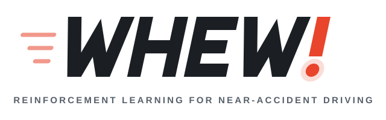
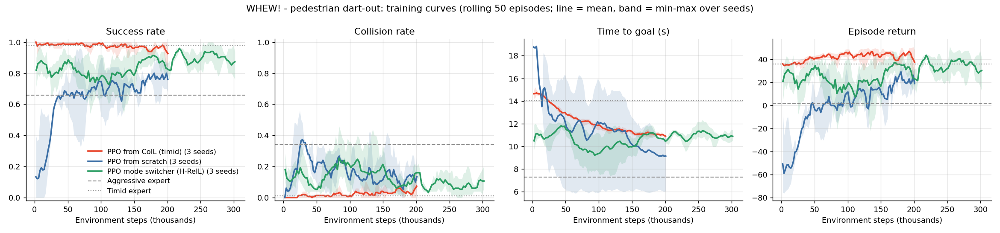
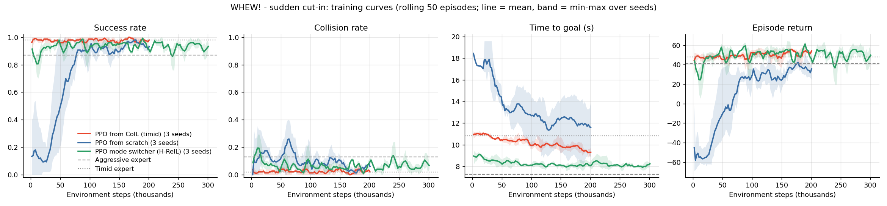
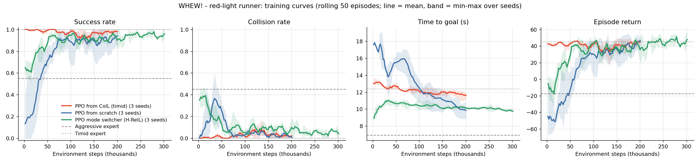
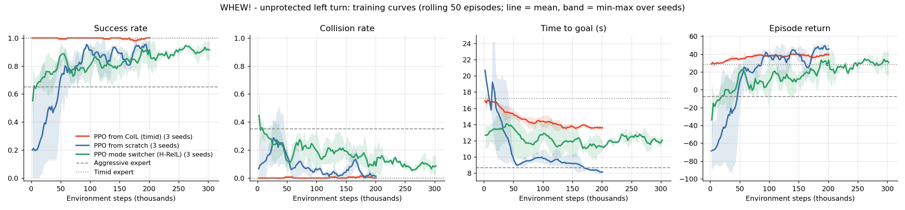

<p align="center">
  <picture>
    <source media="(prefers-color-scheme: dark)" srcset="assets/whew-logo-dark.svg">
    <source media="(prefers-color-scheme: light)" srcset="assets/whew-logo-light.svg">
    
  </picture>
</p>

<p align="center"><i>Bold when it can be. Careful when it must be.</i></p>

---

**WHEW!** is a reinforcement learning project for near-accident driving in the CARLA simulator.
It learns how to drive through the seconds before a potential crash, where a
purely cautious driver is safe but slow and a purely aggressive driver is fast but
crashes. The goal is a policy that is bold when it can be and careful when it must be.

> Status: v0.7. All four scenarios work end to end: expert data, conditional imitation
> learning, PPO fine-tuning, a high-level mode switcher (H-ReIL style) and a PPO-from-scratch
> baseline, evaluated over 3 seeds each.

## Approach

1. **Near-accident scenarios** built on the CARLA simulator.
2. **Expert demonstrations** from two rule-based drivers: *aggressive* and *timid*.
3. **Conditional imitation learning (CoIL)**: one network with a branch per driving style.
4. **Reinforcement learning on top of imitation**, two ways:
   * *fine-tuning*: PPO adjusts the timid CoIL branch's throttle / brake directly;
   * *mode switching* (as in H-ReIL): PPO chooses every 0.25 s whether the aggressive or
     the timid CoIL branch drives.

## Scenarios

| # | Scenario | Status |
|---|----------|--------|
| 1 | **Pedestrian dart-out**: a pedestrian steps into the road from behind a parked car | Working |
| 2 | **Sudden cut-in**: a faster car swerves into the ego lane close ahead and often brakes hard | Working |
| 3 | **Red-light runner**: a hidden car runs its red light and crosses the ego car's path at an intersection | Working |
| 4 | **Unprotected left turn**: turning left across the path of a fast oncoming car | Working |

### Scenario 1: pedestrian dart-out
The ego car drives down a straight road. A parked car hides a pedestrian, who steps
out (80% of episodes) when the ego car is within 12-30 m **or** 1-2 s away, whichever comes
first, at a random walking speed. The time-based trigger means speeding cannot outrun the
pedestrian. The pedestrian can only be observed once they leave the blind spot.

* **Action**: one value in [-1, 1] (throttle if positive, brake if negative); a built-in
  controller keeps the car in its lane.
* **Observation** (7 values): ego speed, distance to goal, distance to the parked car,
  pedestrian visible flag, pedestrian longitudinal / lateral position and lateral speed.
* **Reward**: +1 per metre of progress, -4 per second of driving, -2 per second for each
  m/s above the 50 km/h speed limit, -150 for a collision, +20 for reaching the goal.
  Being fast pays, but never at the cost of a crash or a speeding violation.

### Scenario 2: sudden cut-in
The ego car drives in the right lane of a two-lane road (same direction). A faster car starts
2-8 m ahead in the left lane, paces the ego car at a random gap, and in 85% of episodes swerves
into the ego lane 1.5-3.5 s into the episode, leaving only a few metres. In 70% of cut-ins it
then brakes hard (70-100% brake, down to 0-3 m/s for 1-2 s) before driving on.

* **Reaction delay**: every action takes effect 0.3 s after it is chosen (for all policies,
  experts included), so braking only once the car is already in the lane is often too late.
* **Action / reward**: the same as scenario 1.
* **Observation** (7 values): ego speed, distance to goal, bumper gap to the other car, its
  lateral offset, relative speed and lateral speed, and an in-my-lane flag.

### Scenario 3: red-light runner
The ego car drives straight through a four-way intersection on green (CARLA's Town05, which
has 12 suitable intersections). In 80% of episodes a car on the crossing road runs its red
light and drives straight across. Buildings hide it until it is 15-25 m from the crossing
point. While hidden it adapts its speed to arrive at about the same moment as the ego car,
so speeding up or slowing down far from the intersection cannot dodge it.

* **Reaction delay**: 0.3 s, as in scenario 2.
* **Action / reward**: the same as scenario 1.
* **Observation** (7 values): ego speed, distance to goal, distance to the crossing point, a
  crossing-car visible flag, and its distance to the crossing point, speed and arrival time.

### Scenario 4: unprotected left turn
The ego car turns left at a four-way intersection in Town05 on green, with no turn arrow. In
85% of episodes a fast oncoming car (40-58 km/h) comes straight through, appearing 32-44 m
before the junction around the time the ego car arrives. The driver has to judge the gap:
go first, or wait for it to pass.

* **Steering** follows the curve of the turn automatically; the agent still controls only
  throttle and brake, with the 0.3 s reaction delay.
* **Cornering limit**: CARLA's tyres grip far better than real ones, and a first version let a
  policy take the turn at 50 km/h (2.3 g sideways). Sideways acceleration above 4 m/s^2 is now
  penalised, and above 11 m/s^2 counts as losing control (scored like leaving the road).
* **Observation**: the same layout as scenario 3, for the oncoming car.

## Results

### Scenario 1: pedestrian dart-out

100 unseen scenarios per policy (the same scenario seeds for every policy, disjoint from the
training data). RL methods: 3 training seeds each (200k steps for fine-tuning and from
scratch, 300k for the switcher), mean ± std over seeds; policies act deterministically.

| Policy | Success | Collision | Time to goal | Closest to pedestrian | Top speed | Return |
|---|---|---|---|---|---|---|
| Aggressive expert | 66% | 34% | 7.3 s | 2.9 m | 45 km/h | 2.0 |
| Timid expert | 98% | 1% | 14.1 s | 7.4 m | 34 km/h | 36.2 |
| CoIL, aggressive branch | 66% | 34% | 7.3 s | 2.9 m | 44 km/h | 2.0 |
| CoIL, timid branch | 98% | 1% | 14.0 s | 7.4 m | 35 km/h | 36.5 |
| **PPO from CoIL (timid)** | **97% ± 1%** | 3% ± 1% | **10.8 ± 0.1 s** | 5.1 ± 0.1 m | 45 ± 2 km/h | **46.6 ± 2.1** |
| PPO mode switcher (H-ReIL) | 90% ± 7% | 10% ± 6% | 11.1 ± 0.6 s | 5.3 ± 0.3 m | 43 ± 1 km/h | 33.0 ± 11.6 |
| PPO from scratch | 86% ± 9% | 14% ± 8% | 8.6 ± 2.7 s | 3.4 ± 0.7 m | 63 ± 16 km/h | 22.7 ± 16.1 |

<p align="center"></p>

* **Imitation works**: each CoIL branch reproduces its expert almost exactly.
* **PPO from CoIL** keeps the timid driver's safety (97% success) while reaching the goal
  **23% faster** (14.1 s to 10.8 s), stays under the speed limit, and has the highest return.
  All three seeds end up in almost the same place.
* **PPO from scratch** is far less reliable: results vary strongly between seeds, it crashes
  more (14%), and two of three seeds learned to speed (64-82 km/h) despite the penalty.
  Starting from imitation is safe from the first training step.
* **The mode switcher** learns the intended idea (it drives aggressively 45-69% of the
  time and is faster than the timid expert), but is unstable across seeds: one seed reaches
  99% success in 10.9 s (the best single policy), the other two crash 13-15% of the time.
  It plateaus around 90% success even with 300k training steps. A likely reason: it can only
  pick between two fixed driving styles, and it cannot see the hidden pedestrian, so choosing
  the aggressive branch near the parked car is a gamble. Fine-tuning can learn any
  throttle / brake in between and is far more consistent.
* **Scenario fix (v0.3)**: in v0.2 one from-scratch run learned to drive at ~108 km/h so the
  pedestrian stepped out after the car had passed. The time-based trigger and the speeding
  penalty remove that loophole; all numbers above are from the fixed scenario.
* Caveats: one scenario, 200k training steps, 3 seeds. The collision difference between PPO
  from CoIL (3%) and the timid expert (1%) is small at 100 episodes.

### Scenario 2: sudden cut-in

Same protocol (100 unseen scenarios, 3 training seeds per RL method, mean ± std over seeds).

| Policy | Success | Collision | Time to goal | Closest distance | Top speed | Return |
|---|---|---|---|---|---|---|
| Aggressive expert | 87% | 13% | 7.3 s | 4.1 m | 51 km/h | 41.3 |
| Timid expert | 98% | 2% | 10.8 s | 5.2 m | 42 km/h | 47.8 |
| CoIL, aggressive branch | 87% | 13% | 7.2 s | 4.2 m | 51 km/h | 41.5 |
| CoIL, timid branch | **100%** | **0%** | 10.9 s | 5.2 m | 42 km/h | 51.2 |
| PPO from CoIL (timid) | 95% ± 1% | 5% ± 1% | 9.2 ± 0.3 s | 5.0 ± 0.1 m | 47 ± 2 km/h | 49.1 ± 3.5 |
| **PPO mode switcher (H-ReIL)** | 95% ± 0% | 5% ± 0% | **7.7 ± 0.1 s** | 4.2 ± 0.0 m | 51 ± 0 km/h | **54.1 ± 0.3** |
| PPO from scratch | 86% ± 15% | 14% ± 15% | 7.8 ± 1.5 s | 4.7 ± 0.6 m | 59 ± 11 km/h | 24.6 ± 23.6 |

<p align="center"></p>

* **Here the mode switcher wins**, the opposite of scenario 1. It is almost as fast as the
  aggressive driver (7.7 s vs 7.3 s) but crashes far less (5% vs 13%), has the highest return,
  and all three seeds agree (it picks the aggressive branch 76-82% of the time). A likely
  reason: the other car is visible from the start, so the switcher can tell when cutting
  in is imminent and hand over to the timid branch, while in scenario 1 the danger is hidden.
* **PPO from CoIL** again makes the timid driver faster (10.9 s to 9.2 s), but this time pays
  for it with a few collisions (0% to 5%).
* **The safest policy is the CoIL timid branch** (100% success, 0% collisions), but it is the
  slowest. The reward accepts 5% collisions in exchange for speed: a larger collision penalty
  would move the RL policies towards the timid end.
* **PPO from scratch** is again the least reliable: one seed is good, one has a negative return.

### Scenario 3: red-light runner

Same protocol (100 unseen scenarios, 3 training seeds per RL method, mean ± std over seeds).

| Policy | Success | Collision | Time to goal | Closest distance | Top speed | Return |
|---|---|---|---|---|---|---|
| Aggressive expert | 55% | 45% | 6.9 s | 13.4 m | 51 km/h | -17.4 |
| Timid expert | 100% | 0% | 12.4 s | 19.9 m | 42 km/h | 45.4 |
| CoIL, aggressive branch | 55% | 45% | 6.9 s | 13.3 m | 52 km/h | -17.5 |
| CoIL, timid branch | 100% | 0% | 12.4 s | 20.1 m | 42 km/h | 45.4 |
| PPO from CoIL (timid) | 97% ± 1% | 3% ± 1% | 11.2 ± 0.3 s | 18.9 ± 0.1 m | 47 ± 2 km/h | 44.6 ± 3.3 |
| **PPO mode switcher (H-ReIL)** | **99% ± 2%** | 1% ± 2% | **9.9 ± 0.4 s** | 15.4 ± 0.7 m | 50 ± 1 km/h | **52.5 ± 4.1** |
| PPO from scratch | 91% ± 7% | 3% ± 2% | 8.8 ± 0.4 s | 16.7 ± 0.7 m | 63 ± 6 km/h | 41.4 ± 7.2 |

<p align="center"></p>

* **The mode switcher is best again**: 20% faster than the timid driver (12.4 s to 9.9 s) with
  almost no crashes, where the aggressive driver crashes 45% of the time. Two of its three
  seeds had no collisions in 100 episodes; the third had 4. It uses the aggressive branch
  38-59% of the time.
* **PPO from CoIL** gains less time here (12.4 s to 11.2 s) and adds 3% collisions, so it does
  not beat the timid driver on return.
* **PPO from scratch** is the fastest learned policy, but it exceeds the 50 km/h limit (58-71 km/h)
  and one seed times out in 19% of episodes. Its time to goal counts only successful episodes.
* Caveats: the 0% to 5% collision differences are only a few episodes out of 100 per seed, so
  they are not precise. During training the switcher still crashed about 5% of the time with
  exploration on; the table is for deterministic evaluation.

### Scenario 4: unprotected left turn

Same protocol (100 unseen scenarios, 3 training seeds per RL method, mean ± std over seeds).

| Policy | Success | Collision | Time to goal | Closest distance | Top speed | Return |
|---|---|---|---|---|---|---|
| Aggressive expert | 65% | 35% | 8.7 s | 13.6 m | 51 km/h | -7.7 |
| Timid expert | 100% | 0% | 17.2 s | 11.6 m | 42 km/h | 28.3 |
| CoIL, aggressive branch | 62% | 38% | 8.8 s | 13.3 m | 51 km/h | -12.2 |
| CoIL, timid branch | 100% | 0% | 17.2 s | 11.7 m | 42 km/h | 28.1 |
| **PPO from CoIL (timid)** | **100% ± 0%** | **0% ± 0%** | 13.4 ± 0.2 s | 11.5 ± 0.0 m | 45 ± 1 km/h | 40.6 ± 0.8 |
| PPO mode switcher (H-ReIL) | 89% ± 6% | 11% ± 6% | 11.3 ± 1.4 s | 14.0 ± 0.5 m | 49 ± 2 km/h | 28.6 ± 5.6 |
| PPO from scratch | 95% ± 0% | 2% ± 2% | **7.4 ± 0.2 s** | 16.6 ± 0.6 m | 59 ± 2 km/h | **46.2 ± 2.9** |

<p align="center"></p>

* **PPO from CoIL** is the only policy that never failed (300 of 300 episodes): 22% faster than
  the timid driver (17.2 s to 13.4 s), and all three seeds agree.
* **PPO from scratch** has the highest return. It turns no harder than the aggressive driver
  (both peak at about 7.5 m/s^2 sideways), but speeds up to 59 km/h on the straights, accepting
  the speeding penalty, and loses control of the car in 3% of episodes.
* **The mode switcher** is the weakest RL method here (11% collisions; one seed reaches 97%).
  Neither fixed driving style handles the turn well: the aggressive branch hits the oncoming
  car and the timid one waits too long, and switching between them every 0.25 s does not fix
  that.

### Across all four scenarios

Mean return and success rate over 3 seeds (higher is better):

| Scenario | Timid expert | PPO from CoIL | Mode switcher | PPO from scratch |
|---|---|---|---|---|
| 1. Pedestrian dart-out | 36.2 (98%) | **46.6** (97%) | 33.0 (90%) | 22.7 (86%) |
| 2. Sudden cut-in | 47.8 (98%) | 49.1 (95%) | **54.1** (95%) | 24.6 (86%) |
| 3. Red-light runner | 45.4 (100%) | 44.6 (97%) | **52.5** (99%) | 41.4 (91%) |
| 4. Unprotected left turn | 28.3 (100%) | 40.6 (100%) | 28.6 (89%) | **46.2** (95%) |

* No method wins everywhere. **PPO from CoIL** is the most dependable: it never drops below
  95% success, always beats the timid driver on speed, and its seeds always agree.
* **The mode switcher** is best when the danger can be seen coming (cut-in, red-light runner)
  and weakest when it is hidden (pedestrian) or when neither style fits (left turn).
* **PPO from scratch** is the least reliable overall, and twice found loopholes in the
  scenario design (scenarios 1 and 4) that had to be closed.

---

## Setup

Requirements: Windows or Linux, Python 3.10, an NVIDIA GPU (tested on an RTX 4060 Laptop, 8 GB).

1. Download **CARLA 0.9.15** from the [CARLA releases](https://github.com/carla-simulator/carla/releases)
   and extract it **outside** this repository.
2. Create a virtual environment and install the dependencies:

   ```bash
   python -m venv .venv
   .venv\Scripts\activate          # Linux: source .venv/bin/activate
   pip install -r requirements.txt
   ```
   The `carla` client comes from PyPI (`carla==0.9.15`); the wheel bundled with CARLA
   only supports Python 3.7.
3. Start the simulator (low quality is enough and saves GPU memory):

   ```bash
   CarlaUE4.exe -quality-level=Low
   ```

## Usage

```bash
# Watch the two experts drive (spectator camera follows the car)
python scripts/collect_expert.py --episodes 3 --render --no-save

# 1. Collect demonstrations: 100 episodes per expert -> data/pedestrian_crossing_expert.npz
python scripts/collect_expert.py --episodes 100

# 2. Train conditional imitation learning -> checkpoints/coil.pt
python scripts/train_coil.py

# 3. PPO fine-tuning from the CoIL timid branch, and the from-scratch baseline
for s in 0 1 2; do   # 3 seeds per method
  python scripts/train_ppo.py --init coil --command timid --seed $s --name ppo_from_coil_s$s
  python scripts/train_ppo.py --init scratch --seed $s --name ppo_scratch_s$s
done

# 3b. High-level mode switcher on top of the frozen CoIL branches
for s in 0 1 2; do python scripts/train_switcher.py --steps 300000 --seed $s --name ppo_switcher_s$s; done

# 4. Evaluate everything on the same unseen scenarios, then plot the learning curves
python scripts/evaluate.py --episodes 100 --policies expert:aggressive expert:timid coil:aggressive coil:timid     ppo:checkpoints/ppo_from_coil_s{0,1,2}.pt ppo:checkpoints/ppo_scratch_s{0,1,2}.pt     switcher:checkpoints/ppo_switcher_s{0,1,2}.pt
python scripts/plot_results.py   # results/learning_curves.png and results/summary.md

# Watch a policy drive (spectator camera follows the car)
python scripts/evaluate.py --policies ppo:checkpoints/ppo_from_coil_s0.pt --episodes 5 --render
```

Every script takes `--scenario pedestrian` (default), `cut_in`, `red_light` or `left_turn`, and
loads that scenario's map automatically (Town10HD_Opt for 1 and 2, Town05 for 3 and 4). Files for
scenarios 2-4 go to `data/<scenario>_expert.npz`, `checkpoints/<scenario>/` and `results/<scenario>/`, e.g.

```bash
python scripts/collect_expert.py --scenario cut_in --episodes 100
python scripts/train_coil.py --scenario cut_in
python scripts/train_switcher.py --scenario cut_in --steps 300000 --seed 0 --name ppo_switcher_s0
python scripts/evaluate.py --scenario cut_in --policies switcher:checkpoints/cut_in/ppo_switcher_s0.pt --episodes 5 --render
```

Each PPO run takes about 5-10 minutes (200k steps) on an RTX 4060 laptop with CARLA headless.

## Project structure

```
whew/
  envs/base.py                  # shared CARLA plumbing: routes, actors, reward, reaction delay
  envs/pedestrian_crossing.py   # Scenario 1 as a gymnasium environment
  envs/cut_in.py                # Scenario 2 as a gymnasium environment
  envs/red_light.py             # Scenario 3 as a gymnasium environment
  envs/left_turn.py             # Scenario 4 as a gymnasium environment (curved route)
  scenarios.py                  # scenario registry: env, expert, data / checkpoint / result paths
  experts.py                    # aggressive and timid rule-based drivers for each scenario
  coil.py                       # conditional imitation learning network (one branch per style)
  ppo.py                        # PPO (GAE): CoIL-shaped Gaussian actor, or categorical mode switcher
scripts/
  collect_expert.py             # expert data collection + expert evaluation
  train_coil.py                 # imitation learning
  train_ppo.py                  # PPO fine-tuning / from-scratch baseline
  train_switcher.py             # high-level mode switcher (H-ReIL style)
  evaluate.py                   # compare policies on the same unseen scenarios
  plot_results.py               # learning curves
results/                        # evaluation JSON, learning-curve CSVs and plot (cut_in/, red_light/, left_turn/ for scenarios 2-4)
```

## Roadmap

- [x] Scenario 1 environment and expert drivers
- [x] Conditional imitation learning on the expert data
- [x] PPO fine-tuning from the imitation policy, plus a PPO-from-scratch baseline
- [x] Evaluation: success, collisions, time to goal, closest distance; learning curves
- [x] Several seeds per method and more evaluation episodes
- [x] High-level PPO that switches between the aggressive and timid CoIL branches (as in H-ReIL)
- [x] Scenario 2: sudden cut-in, with a 0.3 s reaction delay
- [ ] Make the switcher more stable in scenario 1 (e.g. memory of recent observations, more modes)
- [x] Scenario 3: red-light runner at an intersection
- [x] Scenario 4: unprotected left turn, with a cornering limit
- [ ] Full steering control and camera input

## Background and credits

* WHEW! extends an earlier course project on conditional imitation learning + PPO in the
  2D CARLO simulator, done jointly with Samrudhi Rao.
* The aggressive / timid formulation follows Cao et al., *Reinforcement Learning based
  Control of Imitative Policies for Near-Accident Driving*, RSS 2020.
* Conditional imitation learning: Codevilla et al., *End-to-end Driving via Conditional
  Imitation Learning*, ICRA 2018.
* Simulator: [CARLA](https://carla.org/) (Dosovitskiy et al., 2017).

## Author

Deepthi M (PES1UG23AM092)
